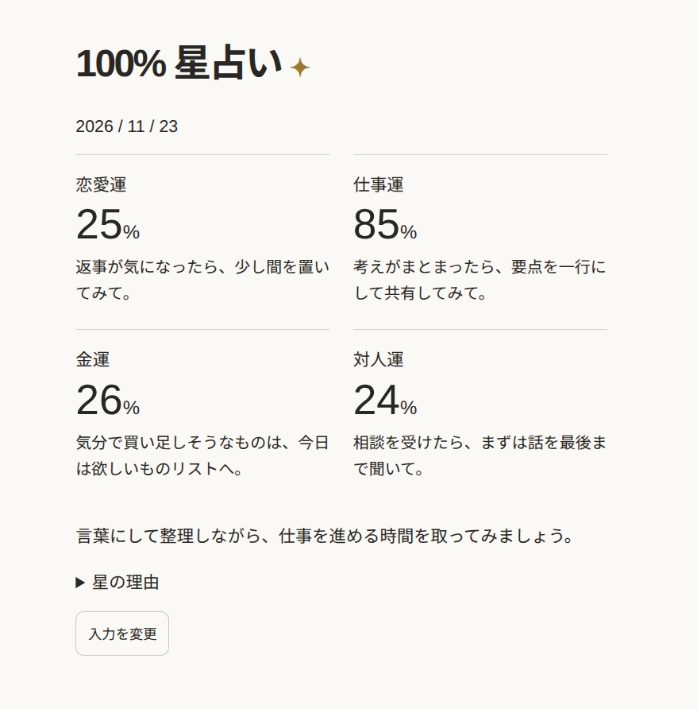

# 100% 星占い

生まれた日の星と、今日の星。その位置関係をもとに、**恋愛運・仕事運・金運・対人運**を占うWebアプリです。4つの運勢を％で表示し、それぞれに、その日の過ごし方を短い言葉で添えます。

[100% 星占いを開く](https://masato-nasu.github.io/horoscope-100pct/)

## 使い方

生年月日と出生地を選んで「占う」を押します。日本生まれなら出生地は「日本（全国）」のままで使えます。出生時刻が分かる場合や、別の日を占いたい場合は「出生時刻・占いたい日」を開いて入力してください。

入力したプロフィールはブラウザに保存されます。次回からは、開くとその日の結果が表示されます。

## 星の読み方

％は、天体同士の角度とその影響の強さから計算した、分野ごとの運勢スコアです。同じ条件で占えば、同じ結果になります。「星の理由」を開くと、今日のひと言に影響した天体の組み合わせと角度を確認できます。

出生時刻が空欄の場合は、生まれた土地の一日を約1時間刻みで調べ、各時点に共通する配置を使います。

[Masato Nasu](https://github.com/Masato-Nasu) · [MASATO LAB](https://masato-lab.pages.dev/)
